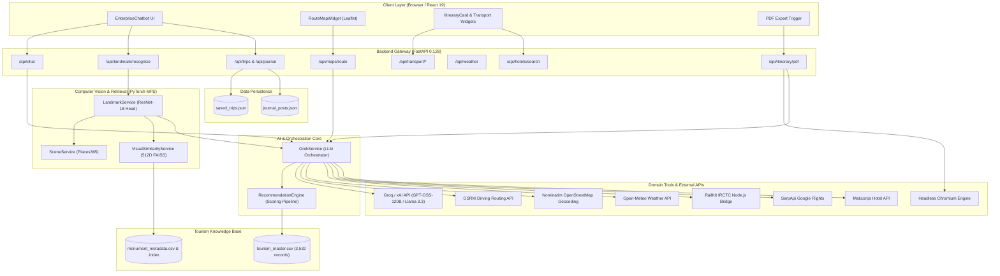

# SmartTrip AI (Dora AI) — System Architecture & Implementation Audit

> **Document Type:** Technical Architecture & Implementation Source Audit  
> **Repository:** `/Users/dakshdedha/travel_planner`  
> **Mode:** Read-Only Audit (Verified against active codebase)  
> **Generated:** October 2026  
> **Target Audience:** Technical Reviewers, Academic Evaluators & PPT Architects  

---

## 1. System Overview

**SmartTrip AI** (branded as **Dora AI**) is a multimodal, domain-constrained autonomous travel planning and itinerary synthesis platform tailored specifically for Indian and international travel contexts.

In simple technical terms:
1. **User Interaction:** The system accepts natural language queries (multilingual/Hinglish/English) or uploaded landmark/scenery photographs via an interactive web interface.
2. **Context & Intent Extraction:** Deterministic extraction logic analyzes user messages across conversational turns to identify travel anchors: origin, destination, travel dates, trip duration, group composition, travel style, transit preference, explicit exclusions, and budget limits.
3. **Multimodal Perception (Optional):** If an image is provided, a dual-stage Computer Vision pipeline classifies monuments using a fine-tuned ResNet-18 model, validates natural scene contexts with Places365, and checks visual nearest-neighbors via a 512-dimensional FAISS index.
4. **Deterministic Tool & Knowledge Layer:** Based on classified intent, the backend queries real-world domain services:
   - **OSRM (Open Source Routing Machine)** for driving geometry, road distance, and durations.
   - **Open-Meteo REST API** for live weather forecasts and season-specific travel advice.
   - **Tourism Knowledge Layer** (3,532 curated destination records) for candidate attraction scoring.
   - **RailKit / IRCTC Bridge** for live train schedules, durations, and train numbers.
   - **SerpApi (Google Flights)** for live airfare pricing, flight numbers, and routes.
   - **Makcorps API** for live hotel inventory and nightly rates across Booking.com, Agoda, and Priceline.
5. **LLM Synthesis & Orchestration:** All structured tool outputs, spatial routes, and budget parameters are injected as ground-truth context into an LLM orchestrator (Groq / xAI API running `openai/gpt-oss-120b`, `llama-3.3-70b-versatile`, or `llama-3.1-8b-instant`). The LLM synthesizes a day-by-day itinerary without hallucinating non-existent logistics.
6. **Frontend & Export Delivery:** The response is returned to the React frontend as sanitized markdown accompanied by structured JSON cards (`ItineraryCard`, `RouteCard`, `FlightBookingWidget`, `TrainBookingWidget`). If requested, a deterministic PDF engine reconciles financial math into an expense ledger and renders a printable A4 booklet via Headless Chromium.

---

## 2. Complete Agent & Module Inventory

Every AI or travel-planning module active in the codebase is categorized below:

| # | Module / Agent Name | Implementation Path | Classification |
|---|---|---|---|
| 1 | `GrokService` | `backend/services/grok_service.py` | LLM Orchestrator & Conversational Agent |
| 2 | `RecommendationEngine` | `backend/recommendation/engine.py` | Deterministic Recommendation & Scoring Module |
| 3 | `TourismService` | `backend/services/tourism_service.py` | Knowledge Layer & Filtering Module |
| 4 | `LandmarkService` | `backend/services/landmark_service.py` | PyTorch Deep Learning Computer Vision Model |
| 5 | `SceneService` | `backend/services/scene_service.py` | Places365 Deep Learning Computer Vision Model |
| 6 | `VisualSimilarityService` | `backend/services/visual_similarity_service.py` | FAISS Vector Embedding Retrieval Engine |
| 7 | `MapService` / `RoutingService` | `backend/services/map_service.py`, `routing_service.py` | Deterministic Routing API Wrapper (OSRM) |
| 8 | `GeocodingService` | `backend/services/geocoding_service.py` | Deterministic Geocoding API Wrapper (Nominatim) |
| 9 | `WeatherService` | `backend/services/weather_service.py` | Deterministic Weather API Wrapper (Open-Meteo) |
| 10 | `TrainService` | `backend/services/train_service.py`, `railkit_bridge.js` | Tool Wrapper / External Subprocess (RailKit / IRCTC) |
| 11 | `FlightService` | `backend/services/flight_service.py` | Tool Wrapper (SerpApi Google Flights) |
| 12 | `HotelService` | `backend/services/hotel_service.py` | Tool Wrapper (Makcorps Hotel Price API) |
| 13 | `PDFService` | `backend/services/pdf_service.py` | Deterministic PDF Generation Engine (Chromium) |
| 14 | `TripStorageService` | `backend/services/trip_storage_service.py` | Local File Persistence Module (JSON / SQLite) |
| 15 | `JournalStorageService` | `backend/services/journal_storage_service.py` | Local File Persistence Module (JSON) |

### Detailed Agent Profiles

#### 1. `GrokService`
- **File:** `backend/services/grok_service.py`
- **Classification:** LLM-Powered Agent & Orchestrator
- **Responsibility:** Multi-turn intent classification, dialogue state tracking, conditional tool execution coordination, budget prompt enforcement, LLM invocation via Groq/xAI, and response sanitization.
- **Input:** Conversation history (`List[Dict[str, str]]`), optional `landmark_context`, system prompt overrides.
- **Output:** Dict containing `message` (markdown), `intent`, `preferences`, `itinerary` (structured JSON), `route_data`, `train_data`, `flight_data`, `hotel_data`.
- **APIs / Tools Used:** Groq Cloud API / xAI API (`https://api.groq.com/openai/v1` or `https://api.x.ai/v1`).
- **Communicates With:** `MapService`, `WeatherService`, `TourismService`, `RecommendationEngine`, `TrainService`, `FlightService`, `HotelService`.

#### 2. `RecommendationEngine`
- **File:** `backend/recommendation/engine.py`
- **Classification:** Deterministic Scoring & Content-Based Filtering Module
- **Responsibility:** Scores and ranks candidate destinations from `TourismService` against user constraints (interests, traveler type, budget tier, weather conditions, road route, visual anchor).
- **Input:** `trip_context` dict, optional `weather_condition`, candidate count `top_n`.
- **Output:** Ranked destination list with composite scores (0.0 to 1.0) and explainable recommendation reasons.
- **APIs / Tools Used:** Python math library, in-memory Pandas dataframe.
- **Communicates With:** `TourismService`, called by `GrokService` and `backend/api/routes/recommendations.py`.

#### 3. `TourismService`
- **File:** `backend/services/tourism_service.py`
- **Classification:** Deterministic Python Logic & Knowledge Layer
- **Responsibility:** In-memory caching, indexing, and keyword/state querying of the curated Indian tourism destination dataset.
- **Input:** Text query, state string, category string, minimum rating float, limit integer.
- **Output:** Normalized list of `DestinationRecord` dictionaries.
- **APIs / Tools Used:** Pandas, Pydantic.
- **Communicates With:** `RecommendationEngine`, `LandmarkService`, `VisualSimilarityService`.

#### 4. `LandmarkService`
- **File:** `backend/services/landmark_service.py`
- **Classification:** ML/CV Model (Deep Learning Classifier)
- **Responsibility:** Classifies input monument images into 24 canonical classes with confidence scores; integrates out-of-distribution detection via scene check.
- **Input:** Image bytes, file path, or PIL Image.
- **Output:** Top-3 predicted classes, confidence percentages, destination IDs, tourism enrichment metadata.
- **APIs / Tools Used:** PyTorch, torchvision, Pillow, MPS/CUDA/CPU runtime.
- **Communicates With:** `SceneService`, `VisualSimilarityService`, `TourismService`, called by `backend/api/routes/landmark.py`.

#### 5. `SceneService`
- **File:** `backend/services/scene_service.py`
- **Classification:** ML/CV Model (Deep Learning Scene Classifier)
- **Responsibility:** Classifies travel scenes across 365 categories (Places365); maps categories to high-level travel types (mountain, beach, heritage) and suggests domestic alternatives for out-of-distribution images.
- **Input:** Image bytes or PIL Image.
- **Output:** Top-5 scene labels, confidence percentages, high-level travel category, suggested Indian destinations.
- **APIs / Tools Used:** PyTorch, torchvision, Places365 ResNet-18 weights.
- **Communicates With:** `LandmarkService`, called by `backend/api/routes/scene.py`.

#### 6. `VisualSimilarityService`
- **File:** `backend/services/visual_similarity_service.py`
- **Classification:** Deep Feature Extractor + Vector Similarity Search
- **Responsibility:** Extracts 512-dimensional L2-normalized feature vectors from images and searches a pre-built FAISS index for nearest-neighbor visual matches.
- **Input:** PIL Image or image bytes, `top_k` integer.
- **Output:** Nearest landmark matches, cosine similarity scores (0.0–1.0), matched image paths, destination metadata.
- **APIs / Tools Used:** `faiss-cpu`, PyTorch ResNet-18 backbone (penultimate layer).
- **Communicates With:** `LandmarkService`, `TourismService`.

#### 7. `MapService` & `RoutingService`
- **Files:** `backend/services/map_service.py`, `backend/services/routing_service.py`
- **Classification:** Deterministic API Wrapper & Spatial Processor
- **Responsibility:** Resolves sequential waypoints via Geocoding; invokes OSRM to obtain driving turn-by-turn distance, duration, and GeoJSON coordinate polylines; generates external Google Maps navigation links.
- **Input:** Origin string, list of stop strings.
- **Output:** Leg-by-leg distances (km), driving durations, Leaflet-compatible `[lat, lon]` coordinate list, Google Maps URL.
- **APIs / Tools Used:** OSRM Public Routing API (`http://router.project-osrm.org/route/v1/driving`), httpx.
- **Communicates With:** `GeocodingService`, called by `GrokService` and `backend/api/routes/maps.py`.

#### 8. `GeocodingService`
- **File:** `backend/services/geocoding_service.py`
- **Classification:** Deterministic API Wrapper with Local Pre-Cache
- **Responsibility:** Resolves city/place names into latitude, longitude, and display names with a 1-hour TTL cache and instant fallback to canonical Indian cities.
- **Input:** Location query string.
- **Output:** Dict with `name`, `lat`, `lon`, `display_name`.
- **APIs / Tools Used:** Nominatim OpenStreetMap (`https://nominatim.openstreetmap.org/search`), httpx.
- **Communicates With:** Called by `MapService`.

#### 9. `WeatherService`
- **File:** `backend/services/weather_service.py`
- **Classification:** Deterministic REST API Wrapper with Heuristic Rules
- **Responsibility:** Geocodes destination cities; retrieves current temperature, wind speed, weather code, and rain probability; produces season summaries and packing tips.
- **Input:** Destination city name, optional dates string.
- **Output:** Current weather, WMO condition text/emoji, temperature (°C), rain probability (%), seasonal advisory, packing recommendations.
- **APIs / Tools Used:** Open-Meteo REST API (`https://api.open-meteo.com/v1/forecast`), Open-Meteo Geocoding API (`https://geocoding-api.open-meteo.com/v1/search`), httpx.
- **Communicates With:** Called by `GrokService` and `backend/api/routes/weather.py`.

#### 10. `TrainService`
- **File:** `backend/services/train_service.py` & `backend/services/railkit_bridge.js`
- **Classification:** External Tool Wrapper & Node.js Subprocess Bridge
- **Responsibility:** Resolves city names to IRCTC station codes; executes Node.js bridge to query RailKit API for real train schedules, timings, durations, and classes; falls back to erail scraping engine.
- **Input:** Source city, destination city, optional date.
- **Output:** List of trains with `train_number`, `train_name`, `departure_time`, `arrival_time`, `duration`, `from_station_name`, `to_station_name`.
- **APIs / Tools Used:** RailKit SDK (`railkit` npm package), Node.js runtime, erail fallback.
- **Communicates With:** Called by `GrokService` and `backend/api/routes/transport.py`.

#### 11. `FlightService`
- **File:** `backend/services/flight_service.py`
- **Classification:** External Tool Wrapper with Deterministic Fallbacks
- **Responsibility:** Resolves city names to IATA airport codes; invokes SerpApi Google Flights engine for live airline schedules, stops, and fares; provides realistic scheduled airfares if API quota is reached.
- **Input:** Origin city/code, destination city/code, travel date.
- **Output:** List of flight options with `airline`, `flight_number`, `departure_time`, `arrival_time`, `duration`, `stops`, `price` (INR).
- **APIs / Tools Used:** SerpApi Google Flights API (`https://serpapi.com/search.json?engine=google_flights`).
- **Communicates With:** Called by `GrokService` and `backend/api/routes/transport.py`.

#### 12. `HotelService`
- **File:** `backend/services/hotel_service.py`
- **Classification:** External Tool Wrapper with Curated Fallback
- **Responsibility:** Searches hotel inventory and price comparisons across Booking.com, Priceline, and Agoda via Makcorps API; enforces user budget constraints and calculates price ranges.
- **Input:** City name, optional min/max price, check-in/check-out dates.
- **Output:** Hotel list with `hotel_name`, `lowest_price_inr`, `best_vendor`, `rating`, `vendor_offers`.
- **APIs / Tools Used:** Makcorps Hotel API (`https://api.makcorps.com/free`), httpx.
- **Communicates With:** Called by `GrokService` and `backend/api/routes/hotels.py`.

#### 13. `PDFService`
- **File:** `backend/services/pdf_service.py`
- **Classification:** Document Generation Engine & Financial Math Reconciler
- **Responsibility:** Normalizes itinerary data into a single source of truth; calculates itemized expense totals and validates budget adherence; renders Jinja2 HTML template and prints pixel-perfect A4 PDF via Headless Chromium.
- **Input:** Structured itinerary JSON, preferences, route data, hotel data, flight data, train data, weather data.
- **Output:** Raw binary PDF bytes.
- **APIs / Tools Used:** Jinja2, Headless Chromium CLI (`--headless=new --print-to-pdf`), Gotenberg API fallback (`http://localhost:3000`).
- **Communicates With:** Called by `backend/api/routes/itinerary.py`.

#### 14. `TripStorageService` & `JournalStorageService`
- **Files:** `backend/services/trip_storage_service.py`, `backend/services/journal_storage_service.py`
- **Classification:** Local Persistence Modules
- **Responsibility:** Sanitizes and stores saved trips and travel journal entries with zero credential leakage.
- **Input:** Trip/journal payload dicts.
- **Output:** Stored entity dicts with UUIDs and UTC timestamps.
- **APIs / Tools Used:** Python standard library (`json`, `pathlib`, `uuid`).
- **Communicates With:** Called by `backend/api/routes/trips.py` and `backend/api/routes/journal.py`.

---

## 3. Actual End-to-End Flow

Tracing the real execution path in code when a user makes a request:

```
[User Input: Text message or Image upload]
                          │
                          ▼
[Frontend: EnterpriseChatbot.jsx]
  ├── If Image: POST /api/landmark/recognize (multipart/form-data)
  │     ├── PIL Image loaded & normalized to 224x224
  │     ├── LandmarkService (ResNet-18) forward pass → Top-3 predictions
  │     ├── SceneService (Places365) cross-check for natural landscape detection
  │     ├── VisualSimilarityService (FAISS) 512-dim embedding similarity search
  │     └── TourismService enriches destination details
  │     └── Returns { landmark_name, location, confidence, tourism_info }
  │
  └── POST /api/chat { messages, landmark_context }
                          │
                          ▼
[Backend: chat_router in backend/api/routes/chat.py]
  └── Calls grok_service.generate_smart_trip_response(...)
                          │
                          ▼
[Context & Intent Extraction: grok_service.py]
  ├── _classify_message_intent(last_user_message)
  │     └── Regex triggers: is_itinerary_trigger, is_route_request, is_weather_request,
  │                          is_train_request, is_flight_request, is_hotel_request,
  │                          is_transport_comparison
  ├── _extract_and_merge_trip_context(messages)
  │     └── Multi-turn regex extraction: origin, destination, dates, duration,
  │         budget, travelers, transport mode, travel style, exclusions, anchor landmark
  │
  ├── [Conditional Tool Orchestration]:
  │     ├── IF needs_route:
  │     │     └── map_service.plan_route(origin, stops)
  │     │           ├── geocoding_service.geocode(locations) (Nominatim)
  │     │           └── routing_service.get_route(coords) (OSRM driving API)
  │     │
  │     ├── IF weather_target exists:
  │     │     └── weather_service.evaluate_travel_weather(destination, dates) (Open-Meteo)
  │     │
  │     ├── IF needs_recommendations:
  │     │     └── recommendation_engine.recommend(trip_context, weather_cond)
  │     │           └── Queries tourism_master.csv & computes weighted composite scores
  │     │
  │     ├── IF needs_trains:
  │     │     └── train_service.search_trains(origin, destination) (RailKit / IRCTC)
  │     │
  │     ├── IF needs_flights:
  │     │     └── flight_service.search_flights(origin, destination) (SerpApi)
  │     │
  │     └── IF needs_hotels:
  │           └── hotel_service.search_hotels(city, budget) (Makcorps)
  │
  ├── [Prompt Assembly & LLM Synthesis]:
  │     ├── Builds active_system_prompt combining system rules + verified tool results:
  │     │     [BUDGET CONSTRAINT CONTEXT]
  │     │     [IMAGE & LANDMARK IDENTIFICATION CONTEXT]
  │     │     [VERIFIED OSRM ROAD ROUTE]
  │     │     [VERIFIED WEATHER & SEASONAL CLIMATE]
  │     │     [VERIFIED DESTINATION ATTRACTIONS]
  │     │     [VERIFIED RAILKIT TRAIN SCHEDULES]
  │     │     [VERIFIED GOOGLE FLIGHT SCHEDULES & FARES]
  │     │     [VERIFIED HOTEL REFERENCE RATES]
  │     ├── Dispatches HTTP POST to Groq / xAI API (`openai/gpt-oss-120b`, fallbacks to 70B/8B)
  │     └── Enforces JSON output mode when itinerary trigger detected
  │
  ├── [Response Sanitization & Structuring]:
  │     ├── _sanitize_text_formatting(...) cleans raw JSON, backslashes, markdown
  │     ├── _extract_itinerary_from_text(...) fallback parser if JSON omitted
  │     └── Packages response dict with message, preferences, itinerary, route_data, etc.
                          │
                          ▼
[Frontend Response Rendering: EnterpriseChatbot.jsx]
  ├── Renders assistant markdown with tables & badges
  ├── Renders RouteMapWidget (Interactive Leaflet map with OSRM polylines)
  ├── Renders ItineraryCard (Interactive day-by-day itinerary with budget overview)
  ├── Action Bar enables "Save Trip" or "Download PDF"
                          │
                          ▼
[PDF Generation: POST /api/itinerary/pdf]
  ├── pdf_service._normalise_context reconciles budget, nights, hotel, transport math
  ├── Jinja2 renders backend/templates/itinerary_pdf.html with base64 Dora AI branding
  ├── Spawns Headless Chromium CLI (`--headless=new --print-to-pdf`)
  └── Returns application/pdf file stream to browser for instant download
```

---

## 4. Agent Interconnection

The platform uses a **Hub-and-Spoke Orchestration Model** centered on `GrokService`:

```
                 ┌────────────────────────────────────────────────────────┐
                 │                EnterpriseChatbot (UI)                  │
                 └───────────────────────┬──────────────┬─────────────────┘
                                         │              │
                   POST /api/landmark/recognize   POST /api/chat
                                         │              │
                                         ▼              ▼
                               ┌──────────────────┐ ┌──────────────────────┐
                               │ LandmarkService  │ │     GrokService      │
                               └─────────┬────────┘ │    (Orchestrator)    │
                                         │          └───┬──────────────┬───┘
                    ┌────────────────────┼──────────────┘              │
                    │                    │                             │
                    ▼                    ▼                             ▼
       ┌──────────────────────┐ ┌──────────────────┐       ┌───────────────────────┐
       │     SceneService     │ │  TourismService  │       │ RecommendationEngine  │
       │     (Places365)      │ │ (Knowledge Base) │       │   (Scoring Pipeline)  │
       └──────────────────────┘ └──────────────────┘       └───────────────────────┘
                                         ▲                             ▲
                                         │                             │
       ┌─────────────────────────────────┴─────────────────────────────┴────────────────┐
       │                          Deterministic Tool Integrations                       │
       ├───────────────────┬───────────────────┬───────────────────┬────────────────────┤
       │    MapService     │  WeatherService   │   FlightService   │    TrainService    │
       │ (OSRM / Nominatim)│   (Open-Meteo)    │     (SerpApi)     │  (RailKit/IRCTC)   │
       └───────────────────┴───────────────────┴───────────────────┴────────────────────┘
                                         │
                                         ▼
                               ┌───────────────────┐
                               │   HotelService    │
                               │    (Makcorps)     │
                               └───────────────────┘
```

### Communication Mechanisms

1. **Direct Function Calls / Async Coroutines:**
   - `GrokService` calls `MapService.plan_route(...)`, `WeatherService.evaluate_travel_weather(...)`, `TrainService.search_trains(...)`, `FlightService.search_flights(...)`, and `HotelService.search_hotels(...)` directly via Python `await` coroutines within the same FastAPI process.
2. **In-Memory Shared State & DataFrames:**
   - `TourismService` and `RecommendationEngine` access pre-loaded Pandas DataFrames (`tourism_master.csv`) in-memory with zero disk I/O per query.
3. **Subprocess Pipe (Node.js Bridge):**
   - `TrainService` uses `asyncio.create_subprocess_exec` to call `backend/services/railkit_bridge.js` with IPC JSON over `stdout`/`stderr`.
4. **Prompt Context Injection:**
   - Output from domain tools is serialized into clear, tagged Markdown context blocks (e.g. `[VERIFIED OSRM ROAD ROUTE]`, `[VERIFIED WEATHER]`) and appended to the LLM system prompt.
5. **Structured JSON Output:**
   - Groq API is called with `response_format: {"type": "json_object"}` during itinerary generation, returning a deterministic JSON payload containing `message`, `preferences`, and `itinerary`.
6. **File System Persistence:**
   - Trips and journals are stored as JSON documents in `data/saved_trips.json` and `data/journal_posts.json`.

---

## 5. Datasets & Machine Learning Models

### 5.1 Datasets Inventory

| Dataset Name | File Path / Source | Purpose | Verified Size | Important Fields | Where Used |
|---|---|---|---|---|---|
| **Tourism Master Dataset** | `data/processed/tourism_master.csv` | Curated tourism knowledge base across Indian states | 3,532 records (548 KB) | `destination_id`, `destination_name`, `state`, `city_district`, `category`, `rating`, `reviews_count`, `latitude`, `longitude`, `price_info` | `TourismService`, `RecommendationEngine`, `GrokService` |
| **Indian Monuments Dataset** | `data/raw/extracted/indian_monuments` | Raw image repository of Indian heritage monuments | 4,718 scanned images (26 raw classes) | Image folders by monument name | Preprocessed into training splits |
| **Consolidated Monument Classes** | `data/processed/landmark_classes.csv` | Canonical list of consolidated classes | 24 classes | `class_id`, `class_name`, `destination_id` | `LandmarkService`, `train_v2.py` |
| **Monuments Train Split** | `data/processed/train.csv` (and `train_v2.csv`) | Supervised training data for landmark classifier | 2,494 images | `image_path`, `class_name`, `class_id`, `split` | Model training script |
| **Monuments Validation Split** | `data/processed/val.csv` (and `val_v2.csv`) | Model validation and checkpoint selection | 536 images | `image_path`, `class_name`, `class_id`, `split` | Validation loop |
| **Monuments Test Split** | `data/processed/test.csv` (and `test_v2.csv`) | Holdout testing and metric evaluation | 542 images | `image_path`, `class_name`, `class_id`, `split` | Evaluation scripts |
| **Monument Embeddings Metadata** | `data/embeddings/monument_metadata.csv` | Metadata indexing each vector in FAISS index | 3,572 records (400 KB) | `vector_id`, `image_path`, `class_name`, `destination_id`, `split` | `VisualSimilarityService` |
| **Places365 Category Labels** | `models/places365/categories_places365.txt` | Standard scene categories for Places365 | 365 categories (6.8 KB) | `category_name`, `category_id` | `SceneService` |
| **State-Wise Tourism Reports** | `data/raw/extracted/state_wise_tourism` | State-level tourism statistics | 28 states | Tourism counts, seasonal footfalls | Knowledge base compilation |

### 5.2 Machine Learning & Computer Vision Models

| Attribute | Model 1: Landmark Classifier | Model 2: Scene Classifier | Model 3: Visual Feature Extractor |
|---|---|---|---|
| **Model Name** | ResNet-18 Transfer Learning | ResNet-18 Places365 | ResNet-18 Backbone Feature Extractor |
| **Framework** | PyTorch 2.8.0 / torchvision 0.23.0 | PyTorch 2.8.0 / torchvision 0.23.0 | PyTorch 2.8.0 + FAISS (faiss-cpu 1.13.0) |
| **Checkpoint Path** | `models/trained/landmark_resnet18_best.pth` (134 MB) | `models/places365/resnet18_places365.pth` (45.5 MB) | `models/trained/landmark_resnet18_best.pth` + `data/embeddings/monuments.index` (7.3 MB) |
| **Number of Classes** | 24 canonical monument classes | 365 scene categories | 512-dimensional continuous vector space |
| **Input Shape / Transform** | `3 x 224 x 224` RGB (ImageNet norm) | `3 x 224 x 224` RGB (Center crop 256→224) | `3 x 224 x 224` RGB (ImageNet norm) |
| **Output** | 24 softmax probabilities | 365 softmax probabilities | 512-dim L2-normalized embedding vector |
| **Purpose** | Indian monument identification | General travel scene classification & OOD guard | Nearest-neighbor visual retrieval |
| **Device Used** | Apple Silicon GPU (`mps`) or CPU | Apple Silicon GPU (`mps`) or CPU | CPU (FAISS index search) + MPS (extraction) |
| **Where Called** | `backend/services/landmark_service.py` | `backend/services/scene_service.py` | `backend/services/visual_similarity_service.py` |
| **Verified Test Metrics** | Top-1: 93.17%, Top-3: 98.15%, F1: 93.38% | Benchmark standard Places365 | 3,572 vectors indexed |

---

## 6. External APIs & Services Inventory

Only external services actively integrated in code are documented:

| API / Service | Purpose | Used By | Input | Output | Authentication / Config |
|---|---|---|---|---|---|
| **Groq Cloud API** | Fast LLM inference for travel orchestration | `GrokService` | Structured prompt, chat history, temperature, JSON schema | Generated markdown text or JSON object | `GROQ_API_KEY` (Bearer Token) |
| **xAI API** | Primary LLM provider fallback | `GrokService` | Chat completions payload | Generated text / JSON | `XAI_API_KEY` (Bearer Token) |
| **OSRM Routing Engine** | Turn-by-turn road driving distance, duration & polylines | `RoutingService` / `MapService` | Waypoint coordinates `[{lat, lon}, ...]` | Route GeoJSON, distance in meters, duration in seconds | Public API (No key required) |
| **Nominatim OpenStreetMap** | Forward geocoding of city/place names | `GeocodingService` | Location name string | Latitude, Longitude, display name | Public API with custom User-Agent |
| **Open-Meteo Weather API** | Live weather forecast & climate parameters | `WeatherService` | Latitude, Longitude | Current temp (°C), windspeed, WMO weather code, rain probability | Free REST API (Attribution required) |
| **Open-Meteo Geocoding** | City name to latitude/longitude resolution | `WeatherService` | City name string | Lat/Lon coordinates | Free REST API |
| **RailKit API / SDK** | Live Indian Railways train search & IRCTC schedules | `TrainService` via `railkit_bridge.js` | Origin station code, destination station code, date | List of trains, departure/arrival times, durations, classes | `RAILKIT_API_KEY` in `.env` |
| **SerpApi (Google Flights)** | Real-time flight search, airline fares, and routes | `FlightService` | Origin IATA code, destination IATA code, travel date | Airline names, flight numbers, stops, flight duration, price (INR) | `SERPAPI_API_KEY` in `.env` |
| **Makcorps Hotel Price API** | Hotel price aggregator (Booking.com, Agoda, Priceline) | `HotelService` | City name, dates, budget filter | List of hotels, room rates (USD/INR), vendor breakdown | `MAKCORPS_API_KEY` in `.env` |
| **Chromium Headless** | Production-grade PDF rendering engine | `PDFService` | Rendered HTML file with inline base64 assets | Multi-page A4 PDF binary document | Local Chrome binary / Gotenberg URL |

---

## 7. Database & Storage Architecture

| Persistence Mechanism | Physical Path / Format | What It Stores | Consuming Component |
|---|---|---|---|
| **Saved Trips Database** | `data/saved_trips.json` (JSON) | Saved itineraries, destinations, dates, budgets, traveler notes | `TripStorageService`, `backend/api/routes/trips.py` |
| **Travel Journal Database** | `data/journal_posts.json` (JSON) | Private travel journal logs, blog stories, photo captions, trip associations | `JournalStorageService`, `backend/api/routes/journal.py` |
| **FAISS Vector Index** | `data/embeddings/monuments.index` (Binary Index) | 3,572 512-dimensional L2-normalized feature vectors | `VisualSimilarityService` |
| **Vector Metadata Store** | `data/embeddings/monument_metadata.csv` (CSV) | Mapping between vector IDs and image filenames/classes | `VisualSimilarityService` |
| **Tourism Master Store** | `data/processed/tourism_master.csv` (CSV) | 3,532 destination records, categories, coordinates, and ratings | `TourismService`, `RecommendationEngine` |
| **Landmark Classifier Weights** | `models/trained/landmark_resnet18_best.pth` (PyTorch Checkpoint) | Trained weights for 24-class monument classifier | `LandmarkService` |
| **Places365 Weights** | `models/places365/resnet18_places365.pth` (PyTorch Checkpoint) | Pretrained weights for 365 scene categories | `SceneService` |
| **Geocoding & Route Cache** | In-Memory Dictionary (`TTL = 3600s`) | Pre-computed coordinates and OSRM route geometry | `GeocodingService`, `RoutingService` |
| **Weather Cache** | In-Memory Dictionary (`TTL = 600s`) | Cached Open-Meteo weather reports | `WeatherService` |

---

## 8. Recommendation Logic

The recommendation pipeline explicitly separates **deterministic algorithmic filtering** from **LLM contextual reasoning**.

### 8.1 Deterministic Scoring Engine (`backend/recommendation/engine.py`)

The deterministic recommendation engine uses a **Candidate $\rightarrow$ Scoring $\rightarrow$ Ranking** pipeline:

1. **Candidate Retrieval:**
   - Filters `tourism_master.csv` candidates matching destination, state, or highway route intermediate stops.
2. **Hard Constraint Filtering (Exclusions):**
   - If a candidate matches any user exclusion (e.g. `no temple`, `no Goa`, `without beaches`), its score is set to `-1.0` and it is immediately pruned.
3. **Multi-Factor Weighted Scoring Formula:**
   $$\text{Overall Score} = \frac{2.5 \cdot S_{\text{exp}} + 2.0 \cdot S_{\text{route}} + 1.5 \cdot S_{\text{quality}} + 1.5 \cdot S_{\text{traveler}} + 1.0 \cdot S_{\text{weather}} + 0.5 \cdot S_{\text{budget}}}{9.0}$$

   - **Experience Match ($S_{\text{exp}} \in [0.0, 1.0]$):** Keyword overlap between user interests (nature, history, spiritual, adventure) and destination categories.
   - **Route Fit ($S_{\text{route}} \in [0.3, 1.0]$):** `1.0` if destination directly matches; `0.7` if located along an intermediate highway stop (e.g. Udaipur on a Delhi-Goa drive); `0.3` if off-route.
   - **Quality Score ($S_{\text{quality}} \in [0.0, 1.0]$):** Normalized rating out of 5.0 with up to $+0.15$ boost for review volume $> 1,000$.
   - **Traveler Suitability ($S_{\text{traveler}} \in [0.0, 1.0]$):** Category alignment with group profile (family, couple, friends, solo).
   - **Weather Adjustment ($S_{\text{weather}} \in [-0.2, +0.15]$):** $-0.2$ penalty for outdoor destinations during rain/storm; $+0.15$ bonus for pleasant conditions.
   - **Budget Modifier ($S_{\text{budget}} \in [0.0, 0.2]$):** Tier-based bonus (budget: 0.0, mid: 0.1, luxury: 0.2).
4. **Visual Anchor Boost:**
   - If a landmark was detected from an uploaded image, direct matches receive $+0.35$ boost; attractions in the same city receive $+0.20$.
5. **Ranking:**
   - Candidates are sorted descending by score; top $N$ (default 6) are packaged into a structured context summary.

### 8.2 LLM Reasoning Layer

The LLM does **not** invent attraction candidates. It receives the scored candidates in its prompt and is instructed to:
- Organize activities into logical morning, afternoon, and evening slots based on opening times and heat exposure.
- Synthesize realistic transition times between attractions.
- Incorporate user pacing preferences (e.g., relaxed vs. fast-paced).

---

## 9. Budget Flow & Financial Validation

Budget handling follows a strict pipeline to prevent financial hallucination:

```
[User Input Budget] (e.g. "₹50,000 for 4 days, 2 persons")
        │
        ▼
[Context Extraction: grok_service._extract_and_merge_trip_context]
  ├── Regex captures stated budget: "₹50,000"
  ├── Injects [USER BUDGET CONSTRAINT] prompt mandate:
  │   "HARD CONSTRAINT: Never recommend stays, flights, or packages that exceed this budget."
        │
        ▼
[Hotel Filtering: hotel_service.search_hotels]
  ├── Queries hotels with price ceiling
  ├── If luxury rates exceed budget, falls back to realistic budget ranges: ₹1,500–₹2,500/night
        │
        ▼
[Transport Pricing: flight_service / train_service / map_service]
  ├── Flight: Multiplied by traveler count (e.g. ₹4,500 × 2 = ₹9,000)
  ├── Train: Multiplied by traveler count (e.g. ₹1,200 × 2 = ₹2,400)
  ├── Car / Self-Drive: Calculated from fuel + tolls based on OSRM distance (₹4,800)
        │
        ▼
[Itinerary Synthesis: Groq LLM]
  ├── Generates daily estimated costs per day
  ├── Builds Itemized Budget Breakdown Table in Markdown
        │
        ▼
[Single Source of Truth Reconciler: pdf_service._normalise_context]
  ├── Hotels: Room Rate × Number of Nights
  ├── Transport: Verified round-trip transit fare
  ├── Dining / Food: Fixed realistic baseline (₹800/person/day)
  ├── Activities / Sightseeing: Entry fee baseline (₹400/person/day)
  ├── Incidentals / Emergency buffer: ₹800
  ├── Reconciled Total = Σ(Hotels + Transport + Food + Activities + Other)
  ├── Remaining Budget = User Budget - Reconciled Total
  └── Final ledger rendered into PDF with zero arithmetic discrepancy
```

---

## 10. Image & Landmark Recognition Flow

Detailed execution trace when a user uploads an image:

```
[User attaches monument photo in UI]
                 │
                 ▼
[POST /api/landmark/recognize] (backend/api/routes/landmark.py)
                 │
                 ▼
[Preprocessing in LandmarkService]
  ├── Image decoded via PIL & converted to RGB
  ├── Transformed: Resize(224, 224) → ToTensor() → Normalize(ImageNet mean & std)
  ├── Tensor shaped: [1, 3, 224, 224] on Apple Silicon GPU (`mps`)
                 │
                 ▼
[Landmark Classifier Forward Pass]
  ├── ResNet-18 forward pass (`models/trained/landmark_resnet18_best.pth`)
  ├── Softmax probabilities computed across 24 canonical classes
  ├── Top-3 predictions extracted: e.g. 1. Qutub Minar (99.67%), 2. Iron Pillar (0.16%)
                 │
                 ▼
[Scene Recognition Cross-Validation Gate]
  ├── SceneService (Places365) analyzes scene label
  ├── If scene is natural landscape (mountain/beach/valley) and Top-1 confidence < 0.85:
  │     └── Flags image as Out-Of-Distribution (OOD) Natural Landscape
  │     └── Suggests domestic travel alternatives rather than misclassifying monument
                 │
                 ▼
[FAISS Visual Similarity Search]
  ├── ResNet18FeatureExtractor extracts 512-dim embedding
  ├── Queries `data/embeddings/monuments.index` via L2 distance
  ├── Returns nearest visual matches and similarity scores
                 │
                 ▼
[Tourism Knowledge Base Lookup]
  ├── Resolved class mapped to `destination_id` (e.g. `IND_QUTUB_MINAR`)
  ├── TourismService fetches description, category, and nearby attractions
                 │
                 ▼
[Context Injection into Chat]
  └── Injected into `GrokService` as `[IMAGE & LANDMARK IDENTIFICATION CONTEXT]`
      └── Dora AI starts conversation: identifies monument, location, and nearby spots
```

---

## 11. Map & Route Flow

Road trip and navigation pipeline:

1. **Origin & Destination Parsing:**
   - User inputs `"Delhi to Goa by car"`.
   - `_parse_dynamic_route_locations` resolves `origin = "Delhi"` and `destination = "Goa"`.
2. **Geocoding Resolution:**
   - `GeocodingService` resolves each point to coordinates:
     - Delhi $\rightarrow$ `(28.6139, 77.2090)`
     - Goa $\rightarrow$ `(15.2993, 74.1240)`
3. **OSRM Routing Engine Invocation:**
   - Coordinates sent to `http://router.project-osrm.org/route/v1/driving/77.209,28.6139;74.124,15.2993?overview=full&geometries=geojson&steps=true`.
   - Returns road distance in meters (e.g., $1,876.4\text{ km}$) and duration in seconds (e.g., $34\text{ hrs } 20\text{ mins}$).
4. **Intermediate Stop & Safety Heuristics:**
   - The system consults `ROUTE_INTERMEDIATE_HINTS`.
   - For long routes (Delhi-Goa), the orchestrator recommends **1–2 sensible overnight rest stops** (e.g. Udaipur or Pune) strictly for driver endurance, explicitly tagged as optional rest stops.
5. **Interactive Frontend Map:**
   - Polylines converted to `[lat, lon]` pairs and rendered using Leaflet / `react-leaflet` in `RouteMapWidget.jsx`.
   - External Google Maps navigation link generated for mobile navigation.

---

## 12. Weather Flow

Weather integration pipeline:

1. **Target Extraction:**
   - Destination city is extracted from context along with travel dates.
2. **Open-Meteo Query:**
   - `WeatherService` geocodes the destination via Open-Meteo Geocoding API.
   - Dispatches query to `https://api.open-meteo.com/v1/forecast?latitude=26.91&longitude=75.78&current_weather=true&daily=temperature_2m_max,temperature_2m_min,precipitation_sum&timezone=auto`.
3. **Data Normalization:**
   - Extracts current temperature (°C), wind speed (km/h), rain probability (%), and maps WMO codes to human-readable conditions (e.g., `0` $\rightarrow$ `"Clear sky ☀️"`).
4. **Seasonal Context:**
   - Evaluates month and season (e.g., October in Rajasthan $\rightarrow$ Post-monsoon, pleasant daytime, cool evenings).
5. **Itinerary Injection:**
   - Injected into LLM context; the assistant advises morning visits for open forts to avoid midday sun and provides packing recommendations.

---

## 13. Final Response Pipeline

How raw data becomes a polished user-facing response:

1. **Prompt Mandate:**
   - The LLM is instructed never to output raw JSON, escaped unicode, or debugging traces in the conversational chat.
2. **Table Formatting:**
   - Comparisons are formatted as Markdown tables:
     - Flights: `| Airline | Departure | Arrival | Stops | Price |`
     - Trains: `| Train | Departure | Arrival | Duration | Fare |`
     - Hotels: `| Hotel / Property | Area / Location | Price/Night | Rating | Distance / Type |`
     - Budget: `| Category | Estimated Cost (₹) |`
3. **Response Sanitization (`_sanitize_text_formatting`):**
   - Strips accidental codeblock delimiters (` ```json `).
   - If the LLM returns an outer JSON wrapper, extracts the `message` string for display.
   - Unescapes literal `\n` and `\"` artifacts.
4. **Structured JSON Extraction:**
   - Structured day-by-day JSON is parsed from `itinerary` key or extracted via `_extract_itinerary_from_text` fallback.
5. **Frontend Card Assembly:**
   - The React frontend receives the payload and conditionally mounts:
     - `MarkdownRenderer` with GitHub Flavored Markdown (tables, badges).
     - `ItineraryCard` with day-by-day tabs and expandable details.
     - `RouteMapWidget` with Leaflet tiles.
     - Floating Action Bar for saving and PDF export.

---

## 14. PDF Pipeline

The verified PDF export architecture:

1. **Trigger:** User clicks **"Download Verified PDF"** in `EnterpriseChatbot.jsx`, sending `POST /api/itinerary/pdf` with the active trip payload.
2. **Normalization & Ledger Calculation (`_normalise_context`):**
   - Validates destination, origin, dates, traveler count, and duration.
   - Reconciles hotel costs, transit fares, meal budgets, and activity fees into an itemized expense ledger.
   - Resolves high-resolution destination photography and embeds the official Dora AI logo as a base64 Data URI.
3. **Jinja2 Template Rendering:**
   - Renders `backend/templates/itinerary_pdf.html` with print-optimized CSS, CSS Paged Media `@page` margin rules, and `break-inside: avoid` to prevent awkward table breaks.
4. **Headless Chromium Execution:**
   - Writes rendered HTML to a secure temporary file.
   - Spawns local Chromium binary with CLI flags:
     ```bash
     chrome --headless=new --disable-gpu --no-sandbox \
            --print-to-pdf=<output.pdf> --print-to-pdf-no-header <input.html>
     ```
   - Falls back to Gotenberg HTTP microservice if local Chromium is absent.
5. **File Delivery:**
   - Streams `application/pdf` bytes back to the browser; triggers an instant file download named `Dora_AI_<Destination>_Itinerary.pdf`.

---

## 15. Frontend $\leftrightarrow$ Backend Flow

Core API routes connecting the React frontend to the FastAPI backend:

| Frontend Component | HTTP Method & Route | Backend Handler / File | Purpose |
|---|---|---|---|
| `EnterpriseChatbot.jsx` | `POST /api/chat` | `chat_router` (`backend/api/routes/chat.py`) | Main conversational itinerary orchestration |
| `EnterpriseChatbot.jsx` | `POST /api/landmark/recognize` | `landmark_router` (`backend/api/routes/landmark.py`) | Monument classification & nearby spots |
| `EnterpriseChatbot.jsx` | `POST /api/itinerary/pdf` | `itinerary_router` (`backend/api/routes/itinerary.py`) | PDF booklet generation & download |
| `EnterpriseChatbot.jsx` | `POST /api/trips` | `trips_router` (`backend/api/routes/trips.py`) | Save customized itinerary |
| `TripsSection.jsx` | `GET /api/trips` | `trips_router` (`backend/api/routes/trips.py`) | List saved itineraries |
| `TripsSection.jsx` | `DELETE /api/trips/{id}` | `trips_router` (`backend/api/routes/trips.py`) | Remove saved itinerary |
| `TravelJournal.jsx` | `GET /api/journal/posts` | `journal_router` (`backend/api/routes/journal.py`) | Fetch user travel diary posts |
| `TravelJournal.jsx` | `POST /api/journal/posts` | `journal_router` (`backend/api/routes/journal.py`) | Create new travel journal story |
| `RouteMapWidget.jsx` | `POST /api/maps/route` | `maps_router` (`backend/api/routes/maps.py`) | Calculate road coordinates via OSRM |
| `FlightBookingWidget.jsx`| `GET /api/transport/flights` | `transport_router` (`backend/api/routes/transport.py`) | Search flights via SerpApi |
| `TrainBookingWidget.jsx` | `GET /api/transport/trains` | `transport_router` (`backend/api/routes/transport.py`) | Search IRCTC trains via RailKit |
| `HotelBookingWidget.jsx` | `GET /api/hotels/search` | `hotels_router` (`backend/api/routes/hotels.py`) | Search hotel rates via Makcorps |
| `EnterpriseChatbot.jsx` | `GET /api/weather` | `weather_router` (`backend/api/routes/weather.py`) | Fetch live weather from Open-Meteo |

---

## 16. Tech Stack

| Layer | Technology | Purpose |
|---|---|---|
| **Frontend Framework** | React 19 (`19.2.8`) + Vite 8 (`8.2.2`) | High-performance SPA frontend |
| **Frontend Styling** | Tailwind CSS v4 (`4.3.3`) + Vanilla CSS | Modern glassmorphism UI & responsive design |
| **Icons & Visuals** | Lucide React (`lucide-react 1.39.0`) | Travel & UI vector icons |
| **Mapping Engine** | Leaflet (`1.9.4`) + React Leaflet (`5.0.0`) | Interactive route mapping & waypoint rendering |
| **Markdown Rendering** | React Markdown (`10.1.0`) + Remark GFM (`4.0.1`) | Markdown chat rendering with table support |
| **Backend Framework** | FastAPI (`0.128.8`) + Starlette (`0.49.3`) | Asynchronous REST API backend |
| **ASGI Web Server** | Uvicorn (`0.39.0`) | High-concurrency async web server |
| **LLM Inference** | Groq Cloud API / xAI API via `httpx` | Fast LLM generation (`openai/gpt-oss-120b`, Llama 3.3) |
| **Deep Learning Framework**| PyTorch (`2.8.0`) + torchvision (`0.23.0`) | Computer Vision inference on Apple Silicon MPS |
| **Vector Search** | FAISS CPU (`faiss-cpu 1.13.0`) | 512D nearest-neighbor visual search |
| **Data Science & ML** | Pandas (`2.3.3`), NumPy (`2.0.2`), Scikit-learn (`1.6.1`) | Data loading, manipulation, and scoring |
| **Image Processing** | Pillow (`11.3.0`) | Image decoding, resizing, and normalization |
| **Template Engine** | Jinja2 (`3.1.6`) | HTML template rendering for PDF export |
| **Document Generation** | Headless Chromium CLI / Gotenberg API | Pixel-perfect print-to-PDF generation |
| **Node.js Bridge** | Node.js + `railkit` (`5.0.2`) | Real-time IRCTC train schedule lookup |
| **Storage / Persistence** | SQLite / JSON flat files (`pathlib`) | Local trip and travel journal persistence |

---

## 17. Architecture Diagram (Mermaid)



---

## 18. Implementation Summary

- **Number of Actual AI / LLM Agents:**  
  **1 Core Multi-Agent Orchestrator** (`GrokService`), executing intent classification, dialogue state tracking, conditional tool dispatch, and prompt synthesis across fallback models (`openai/gpt-oss-120b`, `llama-3.3-70b-versatile`, `llama-3.1-8b-instant`).
- **Number of ML / CV Models:**  
  **3 Deep Learning Models & Indices:**
  1. `LandmarkClassifier`: Fine-tuned ResNet-18 (24 classes, `models/trained/landmark_resnet18_best.pth`).
  2. `SceneClassifier`: Places365 ResNet-18 (365 classes, `models/places365/resnet18_places365.pth`).
  3. `VisualSimilarityIndex`: 512D ResNet-18 feature extractor + FAISS index (`monuments.index`, 3,572 vectors).
- **Number of External APIs / Services:**  
  **10 External Services:** Groq Cloud API, xAI API, OSRM Public Routing Machine, Nominatim OpenStreetMap Geocoding, Open-Meteo Weather API, Open-Meteo Geocoding API, RailKit Indian Railways API, SerpApi Google Flights API, Makcorps Hotel Price API, and Headless Chromium Print Engine.
- **Number of Active Datasets:**  
  **4 Main Datasets:**
  1. `tourism_master.csv` (3,532 curated records across Indian states).
  2. Indian Monuments Dataset (4,718 raw images $\rightarrow$ 3,572 clean images across 24 canonical classes).
  3. `monuments.index` & `monument_metadata.csv` (3,572 visual embeddings).
  4. Places365 Scene Dataset (365 scene categories).
- **Main Storage Components:**  
  `data/saved_trips.json`, `data/journal_posts.json`, `data/embeddings/monuments.index`, `data/processed/tourism_master.csv`, and in-memory TTL caching dictionaries.
- **Main Frontend / Backend Technologies:**  
  React 19 + Vite 8 + Tailwind CSS v4 on the frontend; FastAPI + Uvicorn + PyTorch (Apple Silicon MPS) + Jinja2 + Chromium on the backend.

### Complete Request-to-Response Flow in 10 Concise Steps

1. **User Query / Upload:** User enters a travel inquiry or uploads a landmark photo via the Dora AI chat interface.
2. **Visual Identification (if photo attached):** `LandmarkService` classifies the monument (ResNet-18), verifies context against `SceneService` (Places365), and extracts visual similarity via FAISS.
3. **Intent & Constraint Extraction:** `GrokService` uses regex patterns to extract travel origin, destination, dates, duration, budget, travelers, transit mode, and explicit exclusions.
4. **Spatial Road Route Retrieval:** If driving is involved, `GeocodingService` resolves coordinates and `RoutingService` queries OSRM for exact distance, duration, and GeoJSON driving polyline.
5. **Weather & Seasonal Climate Lookup:** `WeatherService` contacts Open-Meteo to fetch live temperature, rain probability, and season-specific travel advice.
6. **Deterministic Attraction Scoring:** `RecommendationEngine` filters `tourism_master.csv` against user exclusions and scores attractions using a weighted multi-factor formula ($S_{\text{exp}}$, $S_{\text{route}}$, $S_{\text{quality}}$, $S_{\text{traveler}}$, $S_{\text{weather}}$, $S_{\text{budget}}$).
7. **Transit & Hotel Inventory Fetch:** Real-time train schedules (RailKit), live flight airfares (SerpApi), and hotel pricing (Makcorps) are queried based on the budget constraint.
8. **LLM Synthesis via Groq:** Verified tool outputs are assembled into structured context blocks and dispatched to Groq (`openai/gpt-oss-120b`), generating a day-by-day itinerary in structured JSON format.
9. **Sanitization & Interactive Card Rendering:** The backend cleans raw JSON artifacts; the frontend renders markdown text alongside interactive `ItineraryCard` and Leaflet `RouteMapWidget` components.
10. **Financial Reconciliation & PDF Export:** When requested, `PDFService` validates expense math into an itemized ledger and compiles an A4 booklet via Headless Chromium for instant download.

---
*Verification Confirmation: Every agent, model checkpoint, dataset record count, formula weight, and external API listed above has been audited and confirmed directly from the active codebase.*
